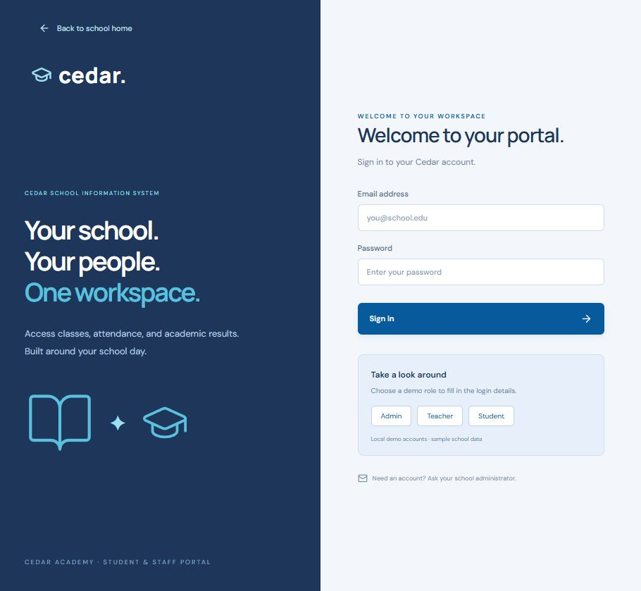

# Cedar — School Management System


## Overview

Cedar is a full-stack school information system with a public academy homepage and role-based portals for administrators, teachers, and students. It brings classes, enrolment, attendance, assessments, announcements, and progress into one focused workspace.

## Highlights

- Public school landing page with responsive layout and subject areas.
- Admin portal for managing people, classes, enrolment, and announcements.
- Teacher portal for assigned-class attendance and assessment records.
- Student portal with personal classes, attendance, results, and feedback.
- Role and record ownership checks enforced by the API.
- SQLite persistence, seeded demo data, hashed passwords, HttpOnly sessions, login throttling, and validated mutations.



A full-stack school workspace with an administrator, teacher and student portal. Built with React 19, TypeScript, Vite, Express 5 and SQLite (Node's built-in `node:sqlite`).

## Run locally

Requires Node.js **24 LTS** and npm.

```powershell
npm install
npm run dev
```

Open http://127.0.0.1:5173. Vite proxies `/api` to the Express API on port 3001. The SQLite database is created and seeded automatically at `data/school.db` on the first start. It survives server restarts and is excluded from source control.

## Demo accounts

All demo accounts use `CedarDemo123!`:

| Role | Email |
| --- | --- |
| Administrator | admin@cedar.demo |
| Teacher | teacher@cedar.demo |
| Student | student@cedar.demo |

The login screen's role buttons fill credentials; select **Sign in** afterward. These are local sample accounts. Replace demo provisioning and credentials before any public deployment.

## Included workflows

- Administrator: create/edit/remove students and teachers; create/edit/remove classes; assign teachers; enrol/unenrol students; publish/delete announcements.
- Administrator and assigned teachers: record daily attendance and assessment scores with feedback.
- Students: view only their enrolled classes, personal attendance and results, plus school announcements.
- Dashboards aggregate real database records. Attendance rate counts present and late records over all recorded attendance. Average result is the unweighted mean percentage across visible assessments.
- Directory and assessment search, class search, responsive navigation, empty states and confirmation before destructive changes.
- Server-side role and record ownership checks, scrypt password hashing, expiring HttpOnly session cookies, basic login throttling, parameterised SQL and validated mutations.

## Checks and production build

```powershell
npm test
npm run build
npm start
```

After building, http://127.0.0.1:3001 serves both the built interface and API. `PORT` changes the API port; update the Vite proxy if changing it during development. Use a persistent volume for `data/` when hosting. `NODE_ENV=production` requires HTTPS because session cookies become Secure. Set `CLIENT_ORIGIN` if using a separate frontend origin; the default deployment serves frontend and API together.

## API

All routes except `POST /api/login` require a session. Authentication uses cookies, not browser local storage.

- `POST /api/login`, `POST /api/logout`, `GET /api/me`
- `GET /api/overview`
- `GET /api/people`, `POST /api/people`, `PUT /api/people/:id`, `DELETE /api/people/:id`
- `GET /api/classes`, `POST /api/classes`, `PUT /api/classes/:id`, `DELETE /api/classes/:id`
- `GET /api/classes/:id/students`, `POST /api/classes/:id/enrolments`, `DELETE /api/classes/:id/enrolments/:student`
- `GET /api/attendance?class_id=1&date=YYYY-MM-DD`, `PUT /api/attendance`
- `GET /api/results`, `POST /api/results`, `DELETE /api/results/:id`
- `POST /api/announcements`, `DELETE /api/announcements/:id`

Deleting a class cascades its enrolments, attendance and results. Unenrolling a student removes their attendance and results **for that class**. Removing a student removes their records across classes. A teacher with assigned classes cannot be removed until classes are reassigned. Admin accounts cannot be deleted through the API.

## Scope

This is a working local first version, not a production school deployment. School calendar dates use Europe/Moscow in both the API and interface. Schedules are descriptive text; the app does not enforce timetable conflicts or academic terms. Email ownership verification, email delivery, password reset/change, audit history, fee collection, file uploads and automated backups are not implemented. Account creation belongs to the administrator; no public registration is provided. Use sample data while evaluating it.

The public school homepage is available at /#home, the login at /#login, and the authenticated dashboard at /#workspace. Landing-page photography loads from Unsplash; a network connection is required for these images. The academy and learning areas are demo content.
